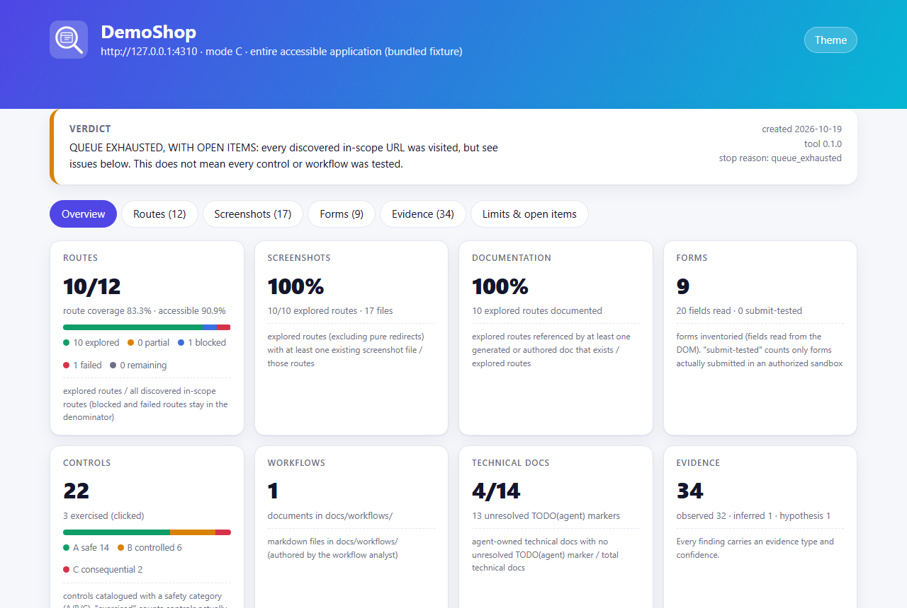
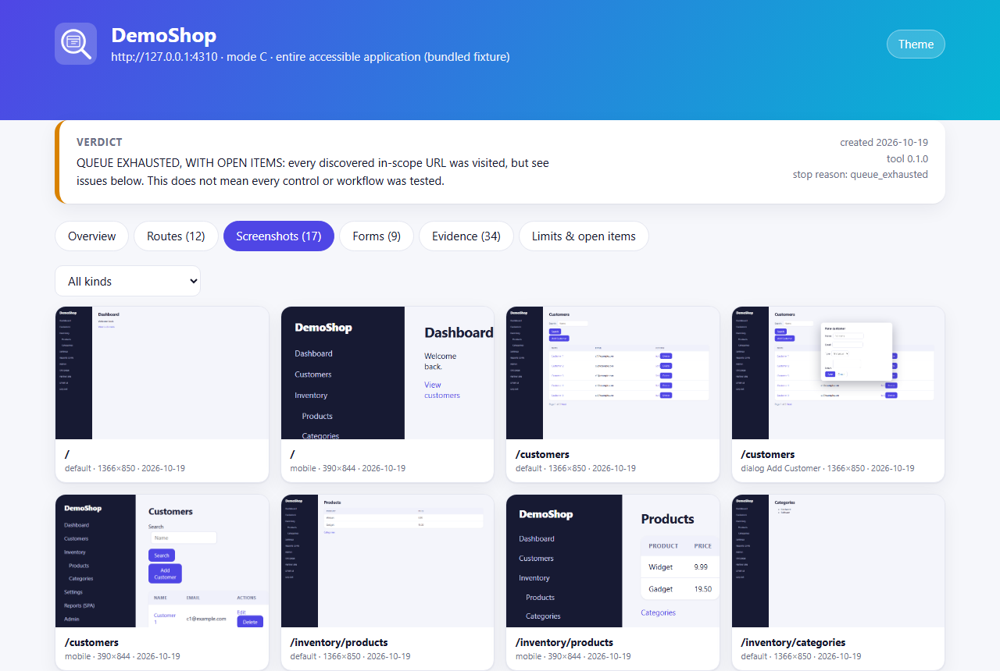
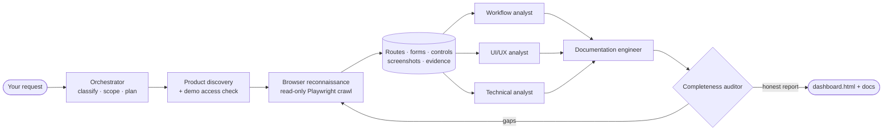

<div align="center">


### A universal AI-agent skill that researches web applications — safely, with evidence.

Point **Claude Code**, **Codex** or any agent that can read Markdown and run a command at a SaaS, ERP, CRM, admin panel or product demo.
Get back a map of every reachable page, real screenshots, form and control inventories, an interactive dashboard, and documentation that a business owner **and** a developer can build from.

[](LICENSE)
[](package.json)
[](https://playwright.dev)
[](#-install)
[](.github/workflows/ci.yml)
[](CONTRIBUTING.md)

[**Landing page**](index.html) · [**User guide**](docs/user-guide.md) · [**Contributing**](CONTRIBUTING.md) · [**Roadmap**](docs/roadmap.md)

</div>

---

## Why WebAppLens?

Studying how a product works usually means days of clicking, screenshotting and note-taking — and the result is an opinion, not evidence. Ask a plain AI agent to “explore this app” and it improvises: it clicks Delete, forgets what it saw, and states guesses as facts.

WebAppLens gives the agent a **disciplined method and a safe toolbox**:

| Without it | With WebAppLens |
|---|---|
| Ad-hoc clicking, lost context when the chat ends | A crawler that checkpoints after every page and **resumes** |
| Risk of changing or deleting real data | A browser-level **mutation guard**: every non-GET request is aborted |
| “It probably uses PostgreSQL” | Every finding tagged **observed / inferred / hypothesis** with confidence caps |
| “Fully explored!” | Separate coverage metrics; **never** claims completeness |
| Notes only the author understands | Plain-English docs for owners + technical docs for developers and AI agents |

## What you get

<table>
<tr>
<td width="50%"><br><sub><b>Interactive dashboard</b> — verdict, metrics with definitions, open issues.</sub></td>
<td width="50%"><br><sub><b>Screenshot gallery</b> — primary states, tabs, dialogs, mobile views.</sub></td>
</tr>
</table>

A research project's `dashboard.html` shows the verdict, metrics with their definitions, a filterable route table, a screenshot gallery (primary states, tabs, dialogs, mobile), a forms explorer, evidence and limits — one self-contained file, light and dark.

**See it in 30 seconds, no external site needed:**

```bash
npm install && npx playwright install chromium
npm run demo            # crawls the bundled fixture app and writes examples/research/DemoShop/
```

then open `examples/research/DemoShop/dashboard.html` in your browser.

> **About the demo.** `npm run demo` crawls **DemoShop — a small fixture app we wrote for the test-suite** ([`tests/fixtures/demo-app`](tests/fixtures/demo-app/server.mjs)), not a real product. It exists so the project can be tested without any external service. Demo and test output is git-ignored; run the tool on apps you are authorized to test, or on vendors’ public demos, to see real results.

Every research project is a folder you can read, share and commit:

```text
docs/references/<AppName>/
├── dashboard.html            ← interactive report (open in any browser)
├── README.md                 ← status + verdict + entry points
├── routes/                   ← route registry, forms.json, controls.json, route-inventory.md
├── screenshots/              ← all/ (pages) · modules/ (tabs) · interactions/ (dialogs, mobile) + manifest
├── docs/
│   ├── modules/*.md          ← plain-English page-by-page guides with screenshots
│   ├── forms-and-fields/     ← every field, type, required flag, options
│   ├── workflows/*.md        ← business workflows (observed vs inferred vs untested)
│   └── technicals/           ← architecture, data model (PROPOSED), API, auth, design system, implementation guide, unknowns
├── evidence/                 ← observations.jsonl (typed + confidence), network summary
├── reports/                  ← completeness, findings, unresolved items
└── crawlers/                 ← config, resumable state, failures, run manifest
```

## Who benefits

| You are… | You get… |
|---|---|
| **Business owner / product manager** | A plain-English tour of a competitor or vendor product: what each module does, which fields matter, which workflows exist — with screenshots. |
| **Designer** | A catalogue of real navigation, table, form and dialog patterns with exact routes. |
| **Developer** | Route maps, form specs, observed API calls, proposed data model and acceptance criteria to build a comparable feature. |
| **AI coding agent** | An implementation guide it can follow without repeating the research. |
| **Analyst / consultant** | Evidence-tagged findings, a transparent product-comparison score and honest limits. |

## How it works



A deterministic **Node CLI** does browsing, bookkeeping and coverage maths. Nine **role playbooks** (`skills/webapp-research/agents/`) guide the agent’s judgement. Agents with sub-agents (Claude Code) delegate; single-agent tools (Codex, Cursor, …) play each role in sequence.

## 🚀 Install

One canonical skill folder — [`skills/webapp-research/`](skills/webapp-research/SKILL.md) — plus an installer that puts it where your agent looks.

```bash
git clone https://github.com/<your-username>/webapplens && cd webapplens
npm install && npx playwright install chromium
```

| Platform | Command | Installs to |
|---|---|---|
| **Claude Code** (all projects) | `node scripts/install.mjs --platform claude --scope user --install-deps` | `~/.claude/skills/webapp-research` + 9 sub-agents in `~/.claude/agents` |
| **Claude Code** (this project) | `node scripts/install.mjs --platform claude --scope project --install-deps` | `.claude/skills`, `.claude/agents` |
| **OpenAI Codex CLI** | `node scripts/install.mjs --platform codex --scope project --install-deps` | `.codex/skills/webapp-research` + pointer block in `AGENTS.md` |
| **Cursor · Gemini CLI · Copilot · Aider · others** | `node scripts/install.mjs --platform agents --scope project --install-deps` | `.agents/skills/webapp-research` + `AGENTS.md` pointer — or `--dest ./tools` and tell your agent to “follow `tools/webapp-research/SKILL.md`” |

<details><summary><b>PowerShell (Windows)</b></summary>

```powershell
git clone https://github.com/<your-username>/webapplens; cd webapplens
npm install; npx playwright install chromium
node scripts/install.mjs --platform claude --scope user --install-deps
node "$env:USERPROFILE\.claude\skills\webapp-research\scripts\cli.mjs" doctor

# credentials: this session only (never paste passwords into chat)
$env:SHOP_USERNAME = 'me@example.com'
$env:SHOP_PASSWORD = Read-Host -MaskInput 'Password'
```
</details>

<details><summary><b>npm package</b></summary>

```bash
npx webapplens install --platform claude --scope user --install-deps   # once published to npm
npx webapplens doctor
```
</details>

Verify: `node <skill-dir>/scripts/cli.mjs doctor` checks Node, Playwright and launches a real Chromium.

> Only the Claude Code and Codex/`.agents` layouts are covered by installer tests. Other tools’ conventions change quickly — the skill itself is just Markdown + a CLI, so if your agent can read `SKILL.md` and run `node`, it works. Found a better layout for your tool? [Open a platform-support issue](.github/ISSUE_TEMPLATE/platform_support.yml).

## ⚡ 60-second tour

Ask your agent in plain language:

| Mode | Example prompt |
|---|---|
| **A · Product** | *“Research Odoo and document how its inventory, sales and accounting modules work.”* |
| **B · Topic** | *“Research how SaaS apps implement role & permission management. Write it up for a Laravel developer.”* |
| **C · Your app** | *“Explore https://app.example.com with the account in `APP_USER`/`APP_PASS`. Document every page, form and workflow.”* |
| **D · Compare** | *“Find the 5 best school-management systems with public demos and compare attendance, fees and exams.”* |

Or drive the CLI yourself:

```bash
CLI="node skills/webapp-research/scripts/cli.mjs"
$CLI init "Acme" --url https://app.acme.test --username-env ACME_USER --password-env ACME_PASS
$CLI crawl "Acme" --probe-openers --responsive     # read-only, resumable (re-run to continue)
$CLI report "Acme"                                 # docs + reports + dashboard.html
$CLI audit "Acme"                                  # honest coverage + link check
$CLI observe "Acme" --type inferred --claim "Invoice numbers look sequential" --route R012
$CLI compare candidates.json --top 5               # transparent product scoring (Mode D)
```

Try it without any external site: `npm run demo` (see above).

## 🛡️ Safe by construction

Instructions can be ignored; code can’t. Safety is enforced in the browser layer:

| Category | Examples | Rule |
|---|---|---|
| **A · Observe** | open pages, switch tabs, search, filter, inspect forms | automatic, in scope |
| **B · Test** | create disposable records, submit to see validation | only in a **confirmed sandbox**, with cleanup |
| **C · Consequential** | delete, send, publish, approve, pay, invite | explicit approval, every time |

- **Mutation guard** aborts every non-GET request (lift only with `--sandbox`; read-only POST APIs like GraphQL need `--allow-post`).
- **Scope policy**: origin allow-list, depth/page/time limits; logout and delete links are never followed.
- **No bypassing**: CAPTCHA and MFA are detected and *refused*; no guessed or leaked credentials.
- **Untrusted content**: page text is data — prompt-injection attempts are logged, never obeyed.
- **Secrets**: env vars or a git-ignored file, never argv; redacted from logs and evidence; saved sessions live in git-ignored `.secrets/`.
- **Resumable & honest**: state checkpointed per page; coverage reported per metric; “fully explored” is never claimed.

Details: [`docs/security.md`](docs/security.md) · [`references/safety.md`](skills/webapp-research/references/safety.md).

## Evidence model

| Type | Meaning | Max confidence |
|---|---|---|
| `observed` | seen in the app | high |
| `verified_interaction` | an authorized action and its result | high |
| `official_docs` / `public_source` | vendor docs / public code | high |
| `inferred` | reasoned from UI behaviour | medium |
| `hypothesis` | needs verification | low |

The CLI enforces the caps, so a UI alone can never “confirm” a database schema or backend framework.

## Tested, not just described

`npm test` runs **37 tests** (unit + integration with a real Chromium against a local fixture app): URL/route templating and sampling, scope enforcement, A/B/C classification, redaction, resume after limits and after a simulated crash, mutation-guard blocking, login failure, form inventory, screenshot manifest, link validation, dashboard safety and installer layouts. Bugs found while building (DOM clobbering of `form.name`, false login detection on a password-change page) each have regression tests.

## Honest limitations

- Screenshots are **not pixel-redacted** — review before publishing.
- Dynamic routes are **sampled** (3 examples per template by default).
- Server-side validation and write workflows are **untested** outside a sandbox.
- Heavily custom SPAs (non-semantic click targets, in-place views) can be partly explored; POST-only read APIs need `--allow-post`.
- Chromium only for now. See the [roadmap](docs/roadmap.md).

## Documentation

[User guide](docs/user-guide.md) · [Architecture](docs/architecture.md) · [Crawler design](docs/crawler-design.md) · [Agent design](docs/agent-design.md) · [Data model](docs/data-model.md) · [Research methodology](docs/research-methodology.md) · [Security](docs/security.md) · [Setup](docs/setup.md) · [Troubleshooting](docs/troubleshooting.md)

## Contributing

WebAppLens is open source and built to be extended — new platform adapters, roles, inspector features, fixtures, docs and real-world compatibility reports are all welcome. Start with [**CONTRIBUTING.md**](CONTRIBUTING.md) (setup, repo tour, how to add a feature, PR checklist) and [`AGENTS.md`](AGENTS.md) if you use an AI agent to contribute. Please read the [Code of Conduct](CODE_OF_CONDUCT.md) and [Security policy](SECURITY.md).

## License

[MIT](LICENSE) © WebAppLens contributors. Use it on applications you own or are authorized to test, or on public vendor demos.
