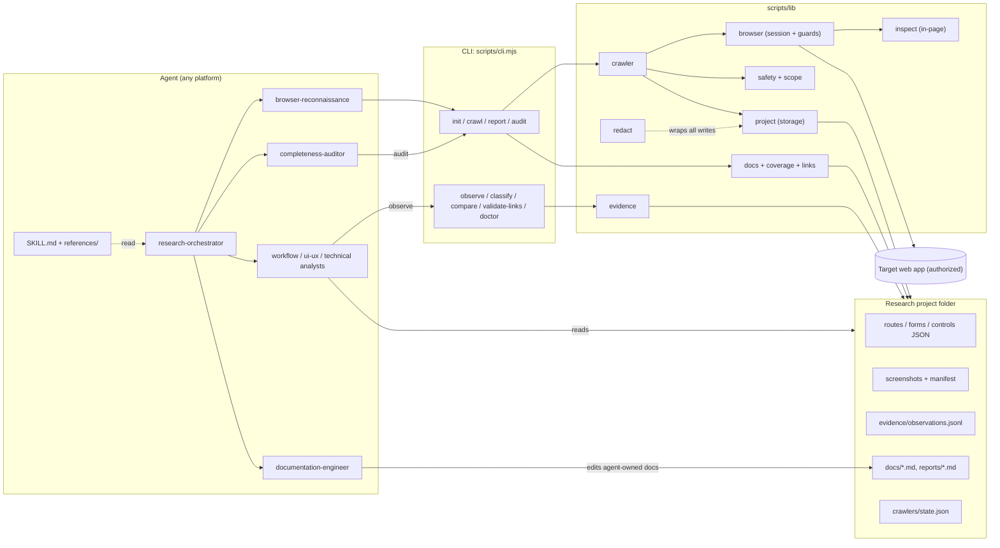

# Architecture

WebAppLens has two halves that meet at a folder of files:

- a **deterministic CLI** (Node.js, Playwright) that browses, does the bookkeeping, and computes coverage; and
- **agent playbooks** (Markdown) that tell an AI agent how to scope, judge, and write analysis on top of what the CLI collected.

There is no server, database, or network service. The research project on disk is the only interface between the two halves, which is what makes the skill portable across agent platforms: any agent that can read Markdown and run shell commands can drive it.

Related: [crawler design](crawler-design.md) · [agent design](agent-design.md) · [data model](data-model.md) · [security](security.md) · [roadmap](roadmap.md) · [CONTRIBUTING](../CONTRIBUTING.md)

## Component diagram

## Layers

| Layer | Files | Responsibility |
|---|---|---|
| Entry point | `skills/webapp-research/SKILL.md` | Name and description (used for skill discovery), the workflow, non-negotiable rules |
| Playbooks | `agents/*.md` (nine), `references/*.md` | Who does what, how to handle modes, safety, evidence |
| CLI | `scripts/cli.mjs` | Argument parsing and dispatch; no business logic |
| Browser | `lib/browser.mjs`, `lib/inspect.mjs` | Playwright session, mutation and scope guards, diagnostics, login; in-page DOM inventory |
| Crawl | `lib/crawler.mjs`, `lib/routes.mjs`, `lib/scope.mjs`, `lib/safety.mjs` | Queue, visit loop, route registry, scope policy, A/B/C classification |
| Storage | `lib/project.mjs`, `lib/util.mjs`, `lib/screenshots.mjs`, `lib/credentials.mjs` | Project layout, atomic JSON, config defaults, screenshot manifest, credential lookup |
| Evidence | `lib/evidence.mjs`, `lib/redact.mjs` | Typed observations with confidence caps; central redaction |
| Output | `lib/docs.mjs`, `lib/coverage.mjs`, `lib/links.mjs`, `lib/scoring.mjs` | Generated Markdown, coverage metrics and verdict, link and TODO scan, Mode D ranking |

Dependency direction is one way: CLI to lib, lib modules to `util`/`redact`. `browser.mjs` is the only module that imports Playwright.

## Data flow of a typical run

1. `init` writes `research-manifest.json`, `crawlers/config.json` (defaults merged with your flags), empty inventories, a `credentials.json` template with env-var **names**, and a `.gitignore`.
2. `crawl` opens a Chromium session, logs in if credentials exist, enables the mutation guard, then loops: visit a URL, inspect, screenshot, record, checkpoint. See [crawler design](crawler-design.md).
3. `report` turns the JSON inventories into Markdown: generated files are rewritten, agent-owned files are created once with `TODO(agent)` markers. It also computes the audit.
4. Analysis agents read the artifacts (no browser), write agent-owned docs, and record findings with `observe`.
5. `audit` recomputes coverage and link validity; the loop repeats until the remaining gaps are only ones that cannot be closed.

## Implemented versus planned

| Capability | Status |
|---|---|
| Read-only Playwright crawler (Chromium), resumable | Implemented |
| Mutation guard, scope policy, A/B/C classification | Implemented |
| Form, field, control, table, dialog inventory | Implemented |
| Screenshots (full page, tabs, dialogs, mobile) with manifest | Implemented |
| XHR/fetch call summary and per-route diagnostics | Implemented |
| Evidence types, confidence caps, redaction | Implemented |
| Generated and agent-owned documentation | Implemented |
| Coverage metrics, verdict, link validation | Implemented |
| Mode D weighted comparison | Implemented |
| Nine role playbooks | Implemented |
| Installer for Claude Code, Codex CLI, generic agent dirs | Implemented (see `scripts/install.mjs`) |
| Unit and integration tests, CI | Implemented |
| Firefox and WebKit | PLANNED |
| HAR export | PLANNED |
| Screenshot redaction masks | PLANNED |
| OpenAPI skeleton from observed calls | PLANNED |
| More login adapters | PLANNED |
| Translated generated docs | PLANNED |
| Accessibility-tree snapshots | PLANNED |
| robots.txt awareness option | PLANNED |

Details and ordering are in the [roadmap](roadmap.md).

## Key decisions

- **Files over services.** JSON, JSONL, and Markdown are diffable, greppable, and readable by any agent. Cost: no concurrent writers; the design assumes one crawl at a time per project.
- **One browser session.** Only `browser-reconnaissance` drives the crawler, so there is a single source of truth for state and no parallel mutation risk.
- **Deterministic code for facts, agents for judgement.** Counting, coverage, and redaction are code. Naming workflows, reading UI patterns, and weighing technical evidence are agent work, labeled with evidence types.
- **Platform neutrality.** The skill is plain Markdown plus a Node CLI. Role playbooks use Claude subagent frontmatter (`name`, `description`, `tools`) because it is simple and readable; other platforms can treat them as plain instructions.
