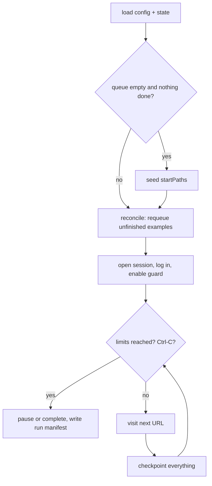

# Crawler design

The crawler is `crawl()` in `skills/webapp-research/scripts/lib/crawler.mjs`. It is a breadth-first, resumable, scope-limited explorer that records an inventory rather than trying to "understand" the app. Understanding is the agents' job.

Related: [architecture](architecture.md) · [security](security.md) · [data model](data-model.md) · [troubleshooting](troubleshooting.md) · [CONTRIBUTING](../CONTRIBUTING.md) · user-facing flags in [references/crawler.md](../skills/webapp-research/references/crawler.md)

## Goals and non-goals

Goals: safe, repeatable, resumable, honest about what it did not see.
Non-goals: submitting forms, testing business logic, load testing, defeating bot protection, replacing a human tester for state-dependent workflows.

## Lifecycle

State is checkpointed after **every page** (routes, forms, controls, failures, network summary, queue, done list). The state file is written atomically (temp file plus rename). Re-running `crawl` resumes from `crawlers/state.json`; limits such as `maxPages` are totals across resumes.

Stop reasons: `queue_exhausted`, `max_pages`, `time_budget`, `interrupted` (SIGINT). Status ends as `completed` if the queue is empty, otherwise `paused`.

## Visiting one page

1. **Navigate** with up to `retries` attempts and exponential backoff; wait for `domcontentloaded`, then up to 4 s of network idle. A browser crash message is rethrown so the main loop can restart.
2. **Classify the outcome:** redirected out of scope is `blocked`; a login form (and not the login path itself) is `blocked: login_required`; 401/403 is `blocked` (403 pages still get a screenshot); 404/410 and 5xx are `failed`; a redirect to another route marks this one explored and queues the target.
3. **Expand menus** (`expandMenus` config): click collapsed `aria-expanded="false"` groups inside `nav`, `aside`, or navigation roles (up to 15, skipping dangerous-looking labels).
4. **Inspect** with the in-page inspector: links, controls, forms and fields, tables, pagination, dialogs, breadcrumbs, technology markers.
5. **Screenshot** the full page once per route, then **harvest**: enqueue links (skipping non-HTTP and category C links), upsert controls with A/B/C categories, upsert forms.
6. **Tabs** (`clickTabs`): click up to `maxTabsPerPage` unselected tabs, screenshot each (`screenshots/modules/`), harvest again, mark them exercised. A tab that changes the URL is enqueued and the page reloaded.
7. **Openers** (`probeOpeners`, off by default): click up to `maxOpenersPerPage` Add/New/Create/Filter-style buttons; if a dialog appears, screenshot it (`screenshots/interactions/`), inventory its form, close it. POSTs are still blocked.
8. **Responsive** (`responsive.enabled`): for up to `responsive.maxRoutes` routes, resize to the mobile viewport and screenshot.
9. **Diagnostics to evidence:** XHR/fetch calls are templated (`GET origin/path/:id`) and counted; console errors, page errors, failed requests, and bad responses are summarized per route; requests blocked by the guard are listed.
10. **Observations:** an `observed` record for the page, and a medium-confidence `observed` record for any framework markers (`ng-version`, `__NEXT_DATA__`, `window.__NUXT__`, Vue/React roots, `meta generator`), worded as "a marker is evidence of a library, not proof of the whole stack".
11. Route result is `explored`, or `partial` if any tab or opener step raised an issue.

## Routes and sampling

`lib/routes.mjs` normalizes URLs (drops tracking parameters and plain anchors, sorts query keys, trims trailing slashes, keeps hash **routes** like `#/reports`) and reduces them to **templates**: numeric ids, UUIDs, 24-char and 32+-char hex ids become `:id`; paging, sorting, and search query keys (`page`, `sort`, `q`, `filter`, ...) do not create new routes. `/customers/12?page=2` and `/customers/13` share the route `/customers/:id`.

Each template visits at most `maxPerTemplate` example URLs (default 3); the rest are counted as `skipped_variants` and reported as sampling in the completeness report. Route status is derived from the results of the examples: all explored is `explored`, a mix is `partial`, all blocked is `blocked`.

Links deeper than `maxDepth` are registered as `discovered` with a note, so they show up as remaining work instead of vanishing.

## Resilience

- **Browser crash:** a crash-looking error restarts the session (reusing the saved storage state) up to `maxRestarts` times and retries the same item.
- **Crash mid-page:** routes left `in_progress` are re-queued by `reconcile` on the next run.
- **Failures** are recorded in `crawlers/failures.json` and the route, never thrown to the user.
- **Torn writes:** JSON is written atomically; the JSONL reader tolerates a truncated last line.
- **Login:** a saved session is reused if still valid; otherwise the generic form login runs (selectors configurable via `auth.*`). A failed login stops before crawling.

## The inspector

`lib/inspect.mjs` exports one function that runs inside the page via `page.evaluate`, so it must stay self-contained. Design points worth knowing:

- Labels are computed from `<label>` text **without nested controls** (a `<select>` in a label would otherwise add its options).
- Radios are grouped by name into one field with options.
- A `<button>` is only `type=submit` if it belongs to a form.
- Form attributes are read with `getAttribute` because fields named `name` or `action` shadow those properties (DOM clobbering). This was a real crash found by running the crawler on a fixture.
- Defaults are withheld for secret-like and file fields; sizes of lists are capped (1500 links, 400 controls, 40 forms, 15 tables).

## Known limitations

- Single-page apps that never change the URL and use non-semantic click targets expose few routes; use `--probe-openers`, add URLs to `startPaths`, or have an analyst drive the app with a browser tool and record via `observe`.
- Only the permissions of one account are seen.
- Form submission, server-side validation, and success/error states are not exercised (by design).
- Chromium only. Firefox and WebKit are [PLANNED](roadmap.md).
- Huge tables and infinite scroll are not exhausted.
